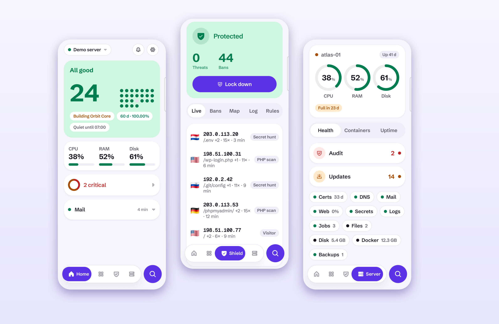
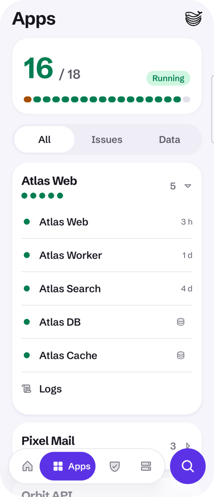
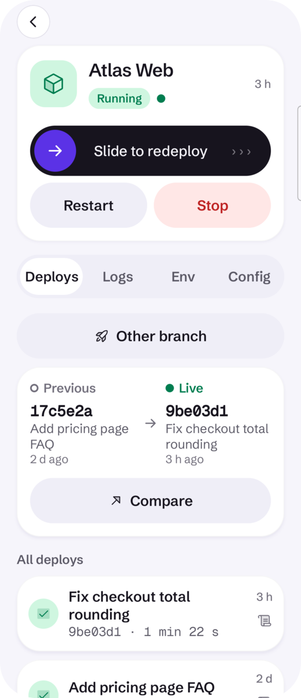
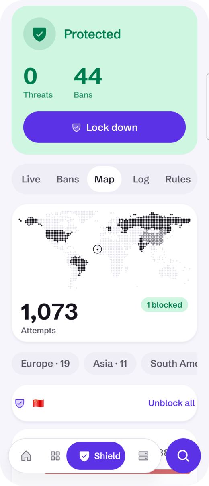
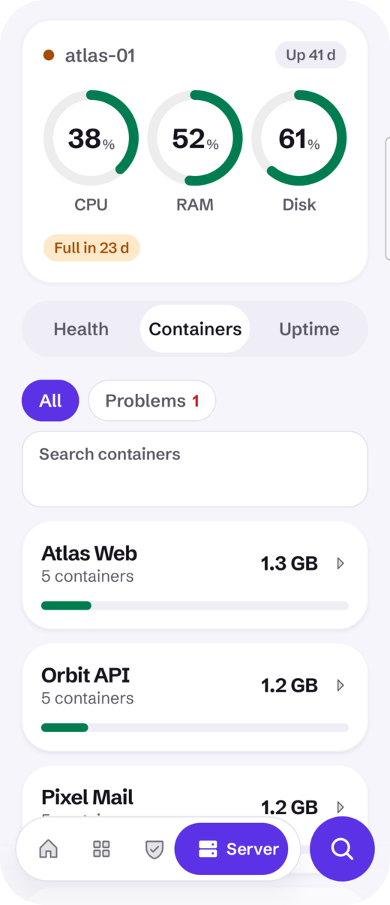
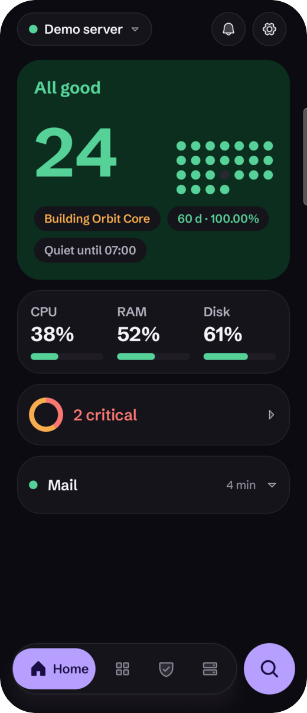
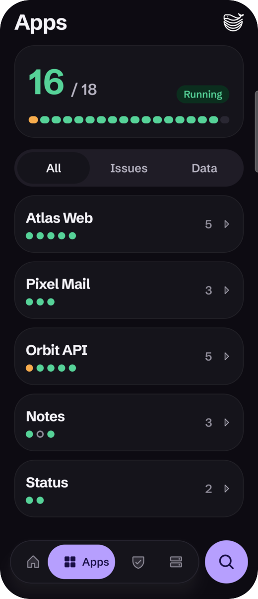
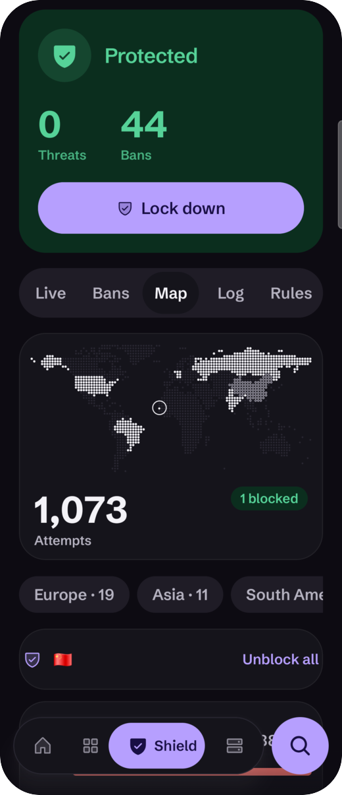
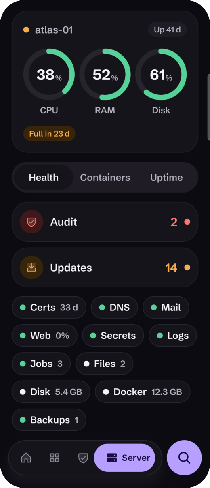

<h1 align="center"><picture><source media="(prefers-color-scheme: dark)" srcset="docs/img/helm-wordmark-dark.svg"></picture></h1>

<p align="center"><b>Your server, in your pocket.</b><br>An Android cockpit for your VPS. Works with Dokploy, Coolify, or a bare server.</p>

<p align="center"></p>

<p align="center">
  <a href="https://github.com/traorecheikh/helm/releases/latest/download/helm.apk"><b>Download the APK</b></a> ·
  <a href="https://traorecheikh.github.io/helm/">Website</a> ·
  <a href="install/README.md">Install the agent</a>
</p>

## What it does

| | |
|---|---|
| **Home** | One card tells you if everything is fine. Orange when something needs a look, red when it is down. |
| **Apps** | Projects, services and deploys. Slide to redeploy, restart, stop, read logs and env. |
| **Shield** | Live probes sorted by what they try, ban or unban in one gesture, attack map by country, lockdown. |
| **Server** | CPU, RAM, disk, containers, uptime, certificates, DNS, mail, backups and a vulnerability audit. |

<p align="center">
  
  
  
  
</p>
<p align="center">
  
  
  
  
</p>

Light and dark follow the system. French and English.

## Works with

- **Dokploy**: apps, composes, databases, deploys, backups.
- **Coolify**: apps, services, databases, deploys, restart.
- **Server only**: Shield, containers, uptime, updates and audit. No platform needed; the Apps tab hides itself.

## Install

On the server (Debian or Ubuntu, as root):

```sh
curl -fsSL https://traorecheikh.github.io/helm/install.sh | sudo sh
```

It installs the agent as a systemd service, sets up fail2ban, creates its own secrets and prints a pairing code. Add `--domain your.host` for automatic HTTPS. Details and every flag are in [install/README.md](install/README.md). To remove it: `sh install.sh --uninstall`.

On the phone: install the APK, enter the server address and the pairing code. The first phone becomes the owner; later phones ask, and the owner approves.

No server yet? Tap **Try the demo** on the first screen. It runs on fictional data.

## Safe by default

A fresh install does **not** enable:

- the SSH country lock,
- automatic reboots,
- automatic redeploys,
- a public listening port (the agent listens on localhost, behind HTTPS).

It does enable security-only package updates. Vulnerability scans and guarded auto-fix are opt-in. Auto-fix never touches databases or services with data volumes unless you allow it, runs only in a quiet window, checks health afterwards and rolls back once if it fails.

## On-device intelligence

Everything runs on the phone: anomaly detection on CPU, RAM and disk, classification of probes (scanner, brute force, you), grouping of log lines, failure causes for builds, alert triage that learns what you open. An optional Gemini Nano summary uses Google ML Kit and stays off until you turn it on. ML Kit sends usage diagnostics to Google; skip the option if that matters to you.

## Build from source

```sh
cd android
./gradlew :app:assembleDebug        # debug build, installs next to a release build
./gradlew :app:testDebugUnitTest    # unit tests
```

Release builds read the signing key from `~/.config/helm-release/keystore.properties` (outside the repository).

```
android/   the app (Kotlin, Jetpack Compose)
agent/     the server agent (Python, one file) and its tests
install/   the one-line installer
site/      the website (Vite, React)
docs/      images
```

## Status

Helm is young. Coolify support was written against its API documentation and has not been tried on a live Coolify. The installer is tested in dry-run and shell checks, not yet on a fleet of fresh servers. Issues and pull requests are welcome.

## Licence

The app (`android/`) is source-available under the [Functional Source License](android/LICENSE) (FSL-1.1, Apache-2.0 future licence): read it, run it, modify it, use it for anything except a competing commercial product, and each version becomes Apache-2.0 two years after release. The agent, the installer and the website are [Apache-2.0](agent/LICENSE). See [LICENSE.md](LICENSE.md). The Dokploy and Coolify marks belong to their projects and are shown to identify the integrations.
